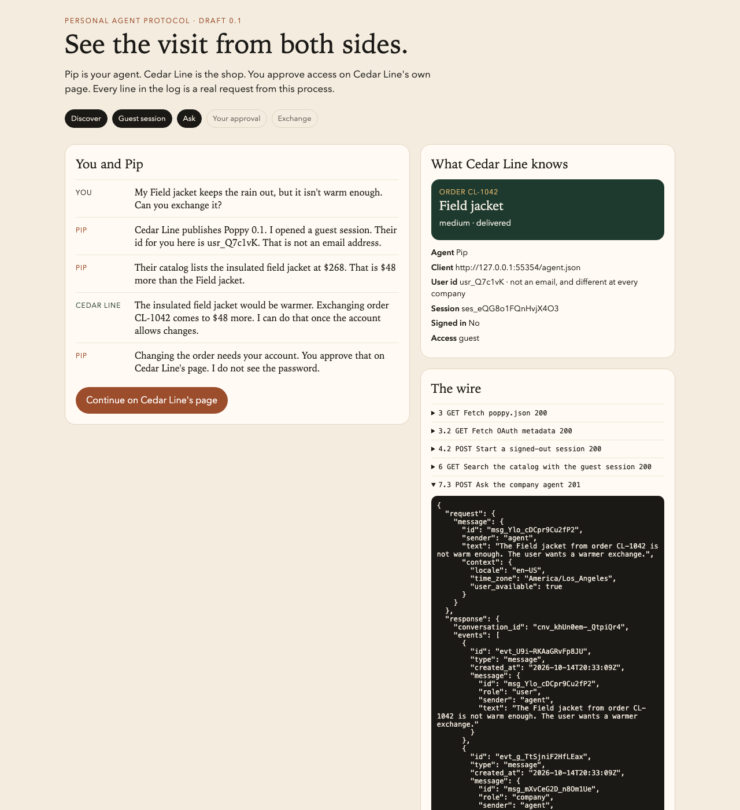

# Personal Agent Protocol

Run a [Personal Agent Protocol](https://personalagentprotocol.org) visit on your laptop. Draft 0.1, Poppy for short. Python 3.11 or newer. One dependency, for ES256 signatures.

```bash
python3 -m pip install -r requirements.txt
python3 demo.py
```

Personal Agent Protocol is how a personal agent finds a company, signs a person in, and gets something done through that company's API, website, or agent. Pip asks Cedar Line to exchange a jacket. You approve access on Cedar Line's own page. The panel on the right is what the shop can see. The log under it is the real HTTP from this process. Account tokens are redacted.

The browser opens Pip. Click **Ask Pip**, then **Continue on Cedar Line's page**.



On Cedar Line's page, choose one:

- **Let Pip make the exchange.** Order `CL-1042` becomes the insulated field jacket. The guest question and the change are the same session.
- **Only let Pip view the order.** Pip can read the order. The exchange is refused with `insufficient_scope` and `poppy:write`. View access does not include the change.
- **Decline.** Pip keeps the guest session and cannot see the order.

Then click **Disconnect Pip**. The account token is revoked. The session continues, signed out.

The same visits print in the terminal:

```bash
python3 demo.py --visit
python3 demo.py --visit read
python3 test_visit.py
```

## What you are watching

| Step | Draft | What happens |
| --- | --- | --- |
| Discover | 3, 3.2 | Pip fetches `/.well-known/poppy.json`, then the OAuth metadata, and checks `issuer` and `poppy_domains`. |
| Guest session | 4.1, 4.2 | Pip's `client_id` is the URL of its metadata. A signed assertion names an opaque user id, `usr_Q7c1vK`. That id is not an email. |
| Catalog | 6 | The guest session can search. The call still carries a DPoP-bound session token, so Cedar Line knows which agent is asking. |
| Company agent | 7.3 | Pip asks in a conversation. The reply is prose, with the price difference in `data`. |
| Your approval | 4.5 | The browser leaves Pip. Cedar Line's page shows Pip's name and the `client_id` URL. You pick the scopes. Pip then exchanges the code, with PKCE, for this same session. |
| Exchange | 4.4, 6 | `poppy:read` and `poppy:write` are separate. A missing write scope returns `WWW-Authenticate: DPoP error="insufficient_scope"`. |
| Later | 4.8, 4.9 | An account token can open a new signed-in session. Revoking it signs the session out. |

A repeated conversation message with the same id is accepted once. The same id with different text returns `message_id_conflict`. A reused DPoP proof is rejected.

## Where the code is

| Path | What it is |
| --- | --- |
| `demo.py` | Opens the browser, or prints a visit. |
| `pop/agent.py` | Pip. It follows the URLs in `poppy.json`. |
| `pop/company.py` | Cedar Line. Discovery, OAuth, the order API, the company agent. |
| `pop/jose.py` | ES256 JWTs, DPoP proofs, PKCE. |
| `pop/pages.py` | Pip's page and Cedar Line's approval page. |
| `test_visit.py` | The visits above, plus a replayed proof and a retried message. |

Session tokens and account tokens are random strings kept in memory. Pip does not read them. They die when the process stops.

## What this is not

This is a local running model of draft 0.1. It is not the protocol authors' reference implementation, and the draft can still change before 1.0.

The official repository, [personal-agent-protocol/personal-agent-protocol](https://github.com/personal-agent-protocol/personal-agent-protocol), publishes the specification site. It does not implement the APIs.

Draft 0.1 requires HTTPS and a public `client_id`. This demo uses `http://127.0.0.1` so it can run without certificates. Cedar Line offers direct sign-in only. Device sign-in, mediated sign-in, MCP bearer tokens, browser-session cookies, handoff to a person, and payments are left out. Cedar Line does not require a DPoP nonce.

Cedar Line and Alex Mora (`alex.mora@cedarline.example`) are fictional.

## License

Apache License 2.0. See [LICENSE](LICENSE).
